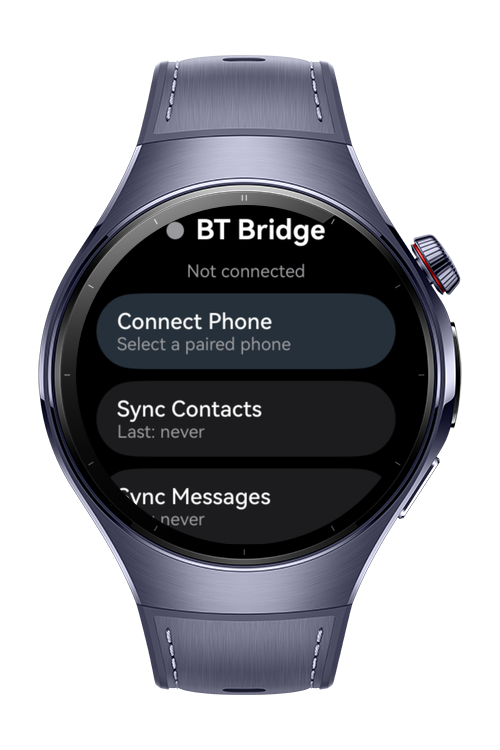
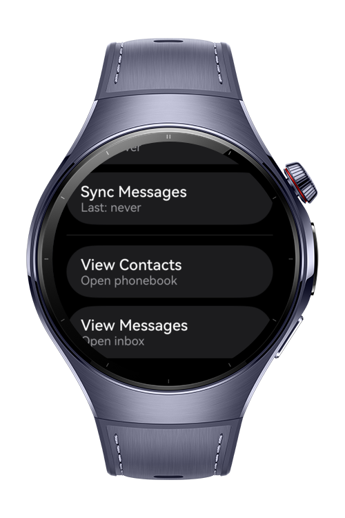
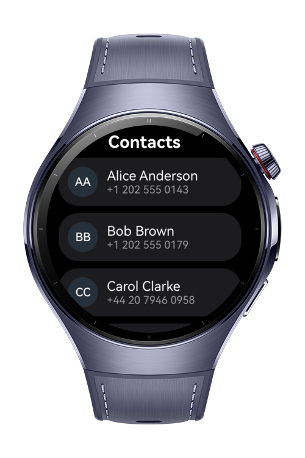
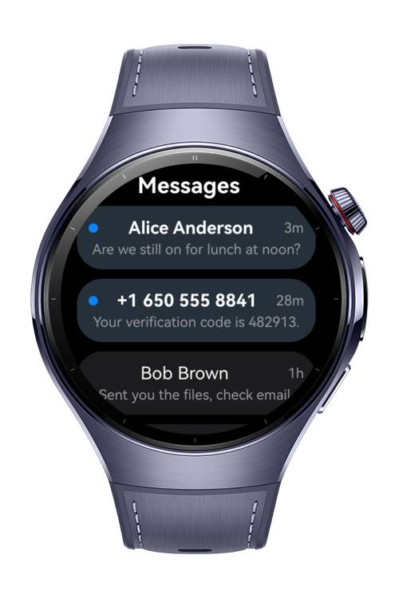

> **Note:** To access all shared projects, get information about environment setup, and view other guides, please visit [Explore-In-HMOS Index](https://github.com/Explore-In-HMOS/hmos-index).

# How To Build Bluetooth Message Phonebook Bridge

`how-to-build-bt-message-phonebook-bridge` — A HarmonyOS ArkTS application that bridges a paired phone to a wearable device over Bluetooth, enabling the watch to display contacts (PBAP) and SMS/MMS messages (MAP) through an SPP/RFCOMM socket channel.

The app uses an offline-first approach with demo data fallback, ensuring the UI is always demonstrable on an emulator even without a companion phone connected.

# Preview

<div>
    
    
    
    
</div>

# Use Cases

- Connect to a paired phone over Bluetooth SPP
- Sync and display phonebook contacts from the companion phone
- Sync and display SMS/MMS messages from the companion phone
- View contact details including phone numbers and email addresses
- View message details with sender and timestamp information
- Fallback to demo data when no phone connection is available

# Tech Stack

**Languages**: ArkTS, ArkUI  
**Frameworks**: HarmonyOS SDK 6.0.1(21)  
**Tools**: DevEco Studio  
**Libraries/Kits**:
- @kit.ArkUI
- @kit.AbilityKit
- @kit.ConnectivityKit
- @kit.BasicServicesKit

# Directory Structure

```
entry/src/main/
├── ets/
│   ├── common/
│   │   ├── AppTheme.ets
│   │   ├── Logger.ets
│   │   ├── StoreKeys.ets
│   │   └── TimeUtil.ets
│   ├── entryability/
│   │   └── EntryAbility.ets
│   ├── entrybackupability/
│   │   └── EntryBackupAbility.ets
│   ├── model/
│   │   └── BridgeTypes.ets
│   ├── pages/
│   │   ├── ContactDetailPage.ets
│   │   ├── ContactListPage.ets
│   │   ├── DevicePickerPage.ets
│   │   ├── Index.ets
│   │   ├── MessageDetailPage.ets
│   │   └── MessageListPage.ets
│   └── service/
│       ├── BluetoothSocketManager.ets
│       ├── BridgeService.ets
│       ├── DemoData.ets
│       ├── MapManager.ets
│       ├── PbapManager.ets
│       └── VCardParser.ets
├── module.json5
└── resources/
```

# Constraints and Restrictions

- The application requires the following user permissions to function properly:

  - `ohos.permission.ACCESS_BLUETOOTH` – for scanning, connecting, and communicating with Bluetooth devices.

- Without the necessary permissions, Bluetooth features will not operate correctly.

## Supported Device

- Huawei Watch 5

# License

**Bluetooth Message Phonebook Bridge** is distributed under the terms of the **MIT License**.  
See the [LICENSE](LICENSE) for more information.
